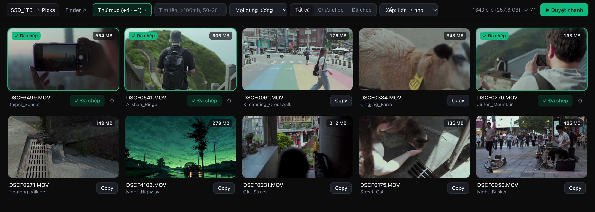

# SSD Video Culler

Zero-dependency macOS / Python local web app to rapidly preview, scrub, filter, and 1-click copy 1,000+ camera videos (`4K H.264`, `HEVC 10-bit`, Fujifilm `PCM 24-bit .MOV`, `.MP4`) from an external SSD into a target folder.



## Key Features

- **Read-Only Source Safety**: Never modifies, moves, or deletes files on your source SSD.
- **Destination-First Matching**: Scans the destination folder first so pre-existing clips (including macOS Finder ` 2.MOV` duplicates) automatically appear as `✓ Đã chép`.
- **Hover-Scrub Contact Sheet + Quick Player**: Glide cursor across thumbnails to scrub `0%–100%`, or open the keyboard-driven Quick Player (`C` / `Enter` to copy & auto-advance).
- **Multi-Folder Include & Exclude**: Select multiple folders at once (`✓`) or hide entire noisy folder trees (`Ẩn` / `✕`).
- **Size Search & Two-Way Sort**: Search directly by size (`>100mb`, `<30mb`, `50-200mb`, `460mb`), filter by MB presets/custom bounds, and sort ascending or descending.
- **ExFAT & Code-Tree Hygiene**: Automatically skips AppleDouble `._*` ghost files, `$RECYCLE.BIN`, `node_modules`, and non-video `.d.mts`/`.mts` TypeScript files.

## Requirements

- macOS (or Linux) with `python3` (3.10+) and `ffmpeg` (`brew install ffmpeg`).
- Safari recommended on macOS for native hardware decoding of 4K `HEVC 10-bit` & `PCM 24-bit` `.MOV` audio (automatic `VideoToolbox` MP4 fallback included for Chromium).

## Quick Start

### Option 1 — Native macOS Desktop App (`WKWebView`)

```bash
./macos/build_app.sh
```

Builds **`~/Desktop/Video Culler.app`** (native Apple Silicon `WKWebView` window with hardware `HEVC 10-bit` & `PCM 24-bit` playback, auto-starting and stopping the local server automatically).

### Option 2 — CLI / Browser

```bash
python3 culler.py --port 8789
```

Or double-click **`Start Video Culler.command`** in Finder.

## Keyboard Shortcuts (Quick Player)

| Key | Action |
| :--- | :--- |
| `C` / `Enter` | Copy current clip to destination & advance to next |
| `→` / `J` | Skip / next clip |
| `←` / `K` | Previous clip |
| `Space` | Play / pause |
| `L` | Skip forward `+3s` |
| `1` – `9` | Jump to `10%` – `90%` of timeline |
| `Z` | Undo last copy (removes destination copy only) |
| `Esc` | Close player |

## Tests

```bash
python3 test_culler.py
```

## License

[MIT](LICENSE)

